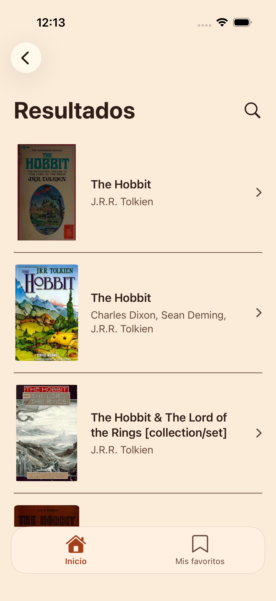
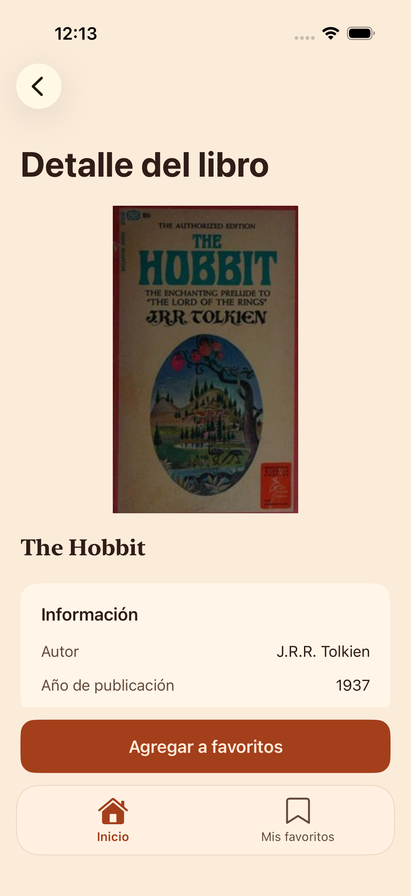
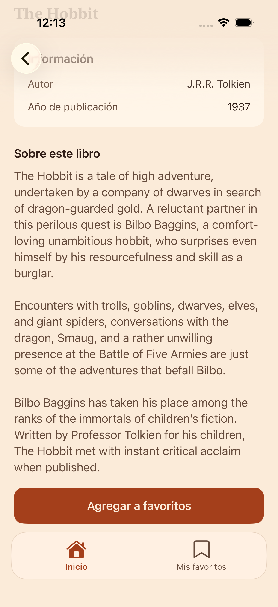
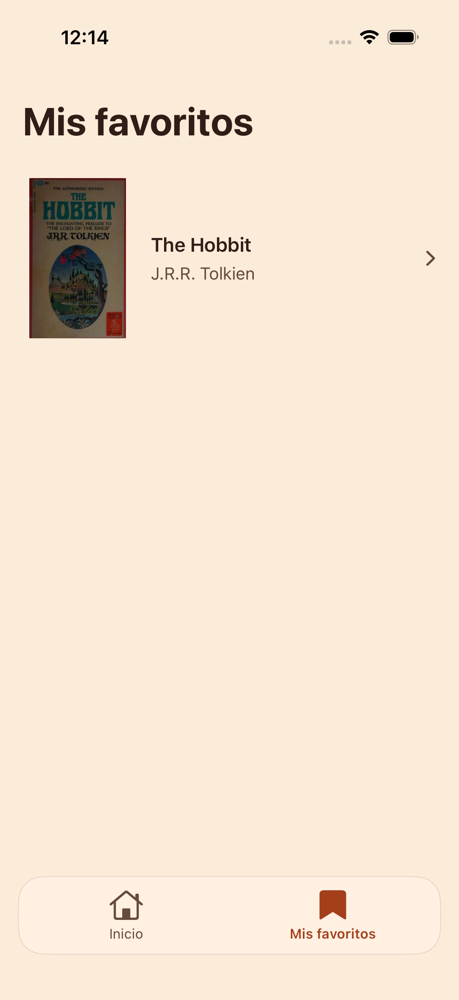
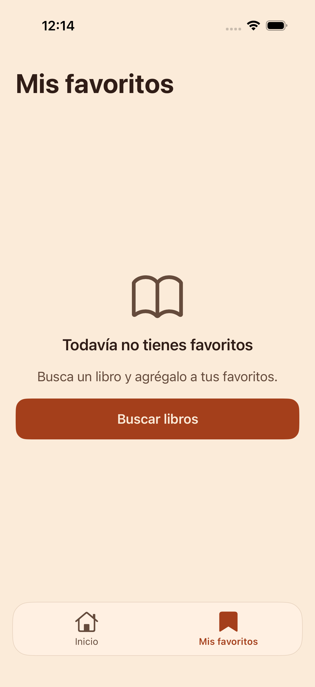

# OpenBooks

OpenBooks es una aplicación para iOS que permite descubrir libros de Open Library, buscar títulos, consultar su información y guardar favoritos en el dispositivo.

## ¿Qué puedes hacer con OpenBooks?

- **Explorar libros en Inicio.** La pantalla principal muestra sugerencias consultadas en Open Library. Se pueden recorrer al desplazarse hacia abajo.
- **Buscar libros.** Escribe un título o una palabra en Buscar y consulta los resultados de Open Library.
- **Consultar detalles.** Abre un libro para ver su portada, título, autor y, cuando estén disponibles, año de publicación, descripción y temas.
- **Guardar y eliminar favoritos.** Los libros seleccionados permanecen en Mis favoritos después de cerrar y volver a abrir la aplicación.
- **Reconocer estados de la aplicación.** Hay indicadores de carga y mensajes para errores de conexión, búsquedas sin resultados, portadas no disponibles y una lista de favoritos vacía.
- **Usar modo claro u oscuro.** La interfaz cambia de colores e ilustración de acuerdo con la apariencia del sistema.

Las sugerencias de Inicio proceden de una búsqueda por tema (`subject:fiction`); no son una clasificación oficial de popularidad.

## Capturas de la aplicación

Estas capturas muestran pantallas de OpenBooks ejecutadas en el simulador de iPhone.

| Inicio | Resultados | Detalle |
| :---: | :---: | :---: |
|  |  |  |

| Descripción | Favorito guardado | Favoritos vacíos |
| :---: | :---: | :---: |
|  |  |  |

## Tecnologías

| Tecnología | Uso |
| --- | --- |
| Swift 5 | Lenguaje de programación del proyecto |
| SwiftUI | Pantallas, navegación e interacción |
| Observation (`@Observable`) | Estado que utilizan las vistas |
| SwiftData | Almacenamiento local de favoritos |
| Foundation y `URLSession` | Solicitudes HTTPS y lectura de JSON |
| `Decodable` | Conversión de las respuestas de Open Library a modelos Swift |
| XCTest | Pruebas unitarias de búsqueda, respuestas y persistencia |
| Xcode | Compilación y ejecución en iPhone o simulador |

## Requisitos

- Una **Mac con Xcode 15 o posterior** y un SDK compatible con iOS 17 o posterior.
- Un simulador de iPhone o un dispositivo físico compatible con **iOS 17.0 o posterior**.
- Conexión a Internet para consultar nuevos libros, sus datos y las portadas disponibles.
- Para ejecutar la aplicación en un iPhone físico, configurar la firma con un equipo de desarrollo en Xcode.

No es necesario registrarse en Open Library, crear una clave API ni instalar paquetes de terceros para ejecutar este proyecto.

## Instalación y ejecución

1. Clona el repositorio o descarga su contenido en ZIP.
2. En una Mac, abre `OpenBooks.xcodeproj` con Xcode.
3. Selecciona el esquema **OpenBooks** y un simulador de iPhone compatible.
4. Presiona **Run** (⌘R).
5. En Inicio, abre una sugerencia o utiliza **Buscar libros**. Desde el detalle puedes agregar un libro a **Mis favoritos**.
6. Para verificar que los favoritos se guardan, cierra y vuelve a abrir la aplicación **sin eliminar los datos**.

Si las sugerencias o la búsqueda no cargan, revisa la conexión a Internet y utiliza la opción para intentarlo nuevamente. Open Library es un servicio externo y puede tardar o presentar errores temporales.

## Open Library y servicios externos

OpenBooks consulta la API pública de [Open Library](https://openlibrary.org/developers/api) mediante HTTPS. Los endpoints utilizados son:

| Uso | Endpoint |
| --- | --- |
| Búsqueda y sugerencias | `GET https://openlibrary.org/search.json` |
| Detalle de una obra | `GET https://openlibrary.org/works/{workID}.json` |
| Portada de un libro | `GET https://covers.openlibrary.org/b/id/{coverID}-M.jpg?default=false` |

La búsqueda utiliza los parámetros `q`, `fields` y `limit=15`. La aplicación pide identificador, título, autores, primera fecha de publicación y portada. Para el detalle se consultan la descripción y los temas cuando hace falta esa información.

**Configuración de la API:** no requiere token, contraseña ni archivo de credenciales. Las direcciones del servicio están definidas en `OpenBooks/Services/OpenLibraryBookSearchService.swift`.

El año de publicación es opcional: cuando Open Library no lo proporciona, no se muestra esa fila. Si una obra no tiene descripción, la aplicación lo indica. Las descripciones y los temas se presentan en el idioma registrado en Open Library; no se traducen automáticamente.

## Organización del proyecto

```text
OpenBooks/
├── Assets.xcassets/     Imágenes y colores
├── Models/             Modelos de libros y respuestas JSON
├── Services/           API de Open Library y almacenamiento
├── ViewModels/         Estado de búsqueda y favoritos
├── Views/              Pantallas y componentes visuales
└── OpenBooksApp.swift   Inicio y configuración de la aplicación

OpenBooksTests/          Pruebas unitarias XCTest
Docs/                    Documentación técnica y capturas
```

La aplicación utiliza una organización basada en MVVM: las vistas presentan el contenido; los modelos representan los libros; los ViewModels administran el estado; y los servicios realizan las solicitudes de red y el acceso a datos locales.

Para conocer los archivos y responsabilidades, consulta:

- [Arquitectura y servicios](Docs/arquitectura-y-servicios.md)
- [Navegación y manejo de estado](Docs/navigation-and-state.md)
- [Organización MVVM](Docs/mvvm-proposal.md)
- [Pruebas y persistencia](Docs/pruebas-y-persistencia.md)

## Pruebas

El objetivo `OpenBooksTests` contiene **24 métodos de prueba XCTest** para modelos de respuesta, estados de búsqueda y favoritos. Los casos de búsqueda usan respuestas controladas y los de persistencia utilizan SwiftData en memoria, por lo que no necesitan llamar a Open Library.

En Xcode, selecciona el esquema **OpenBooks** y ejecuta **Product → Test** (⌘U). También puedes hacerlo desde una Mac por Terminal, reemplazando `NOMBRE_DEL_SIMULADOR` por uno instalado:

```bash
xcodebuild -project OpenBooks.xcodeproj -scheme OpenBooks \
  -destination 'platform=iOS Simulator,name=NOMBRE_DEL_SIMULADOR' \
  CODE_SIGNING_ALLOWED=NO test
```

La presencia de las pruebas no significa que hayan pasado en todas las versiones del proyecto. Para conocer el resultado de una versión concreta, consulta la ejecución correspondiente en Xcode o en la integración continua del repositorio.

## Limitaciones conocidas

- Open Library puede responder lentamente o devolver datos incompletos. La aplicación informa los errores, pero no controla la disponibilidad del servicio.
- Algunas obras no incluyen año, portada o descripción. Las descripciones y temas pueden aparecer en inglés.
- Los favoritos se almacenan **localmente** con SwiftData; no se sincronizan entre dispositivos ni requieren cuenta.
- Las sugerencias recientes pueden recuperarse de `UserDefaults` y las portadas descargadas se guardan temporalmente en caché. Esa caché puede borrarse sin eliminar los favoritos.
- No incluye lectura de libros completos, compras, reseñas ni recomendaciones personalizadas con IA.
- El recorrido completo con VoiceOver y la experiencia en un dispositivo físico requieren revisión adicional.
- Si SwiftData no puede iniciar su contenedor local, la aplicación todavía no ofrece un mecanismo alternativo de recuperación.

## Integrantes

- Romero Palacios Randy Rodrigo
- Villanueva García Emanuel

## Diseños y capturas de referencia

Las siguientes imágenes conservan los diagramas, diseños y capturas anteriores. Pueden servir para comparar la distribución de las pantallas con la interfaz actual.

<details>
<summary>Ver diagramas y wireframes</summary>


</details>

<details>
<summary>Ver capturas de referencia de otras versiones</summary>


</details>
